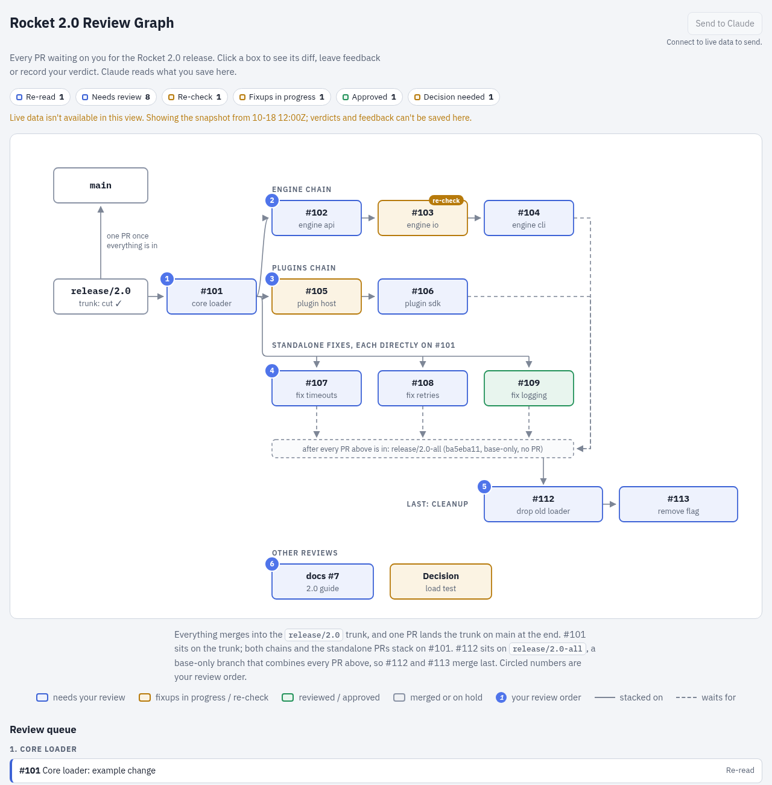
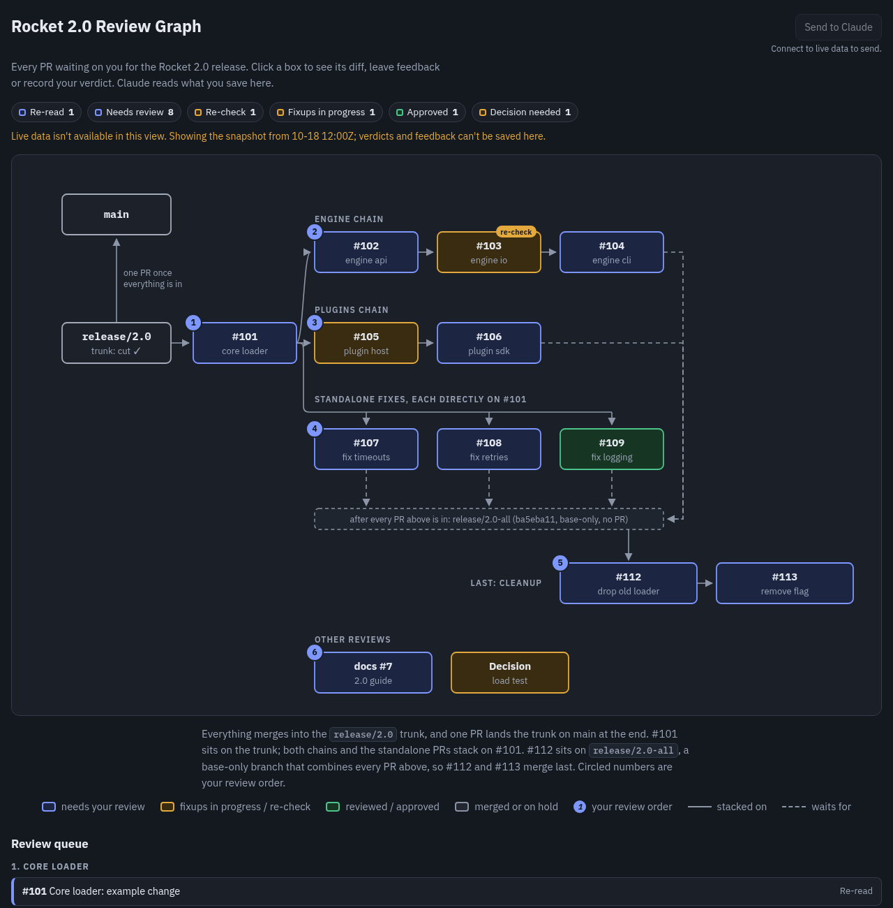

# pr-review-graph

A [Claude Code](https://claude.com/claude-code) skill that turns a set of GitHub PRs and issues into an interactive **review graph**, from one JSON config. You write the config; there is no page code to write.

Use it when parallel work (often subagents) is producing a pile of stacked PRs for you to review, and you want to see the stacking, the merge order and what still needs you in one place.



<details>
<summary>Dark theme</summary>



</details>

## What you get

- Boxes in labeled chain rows, sibling PRs hanging off a bus, and a dashed "waits for" bar for PRs that merge last.
- Circled review-order numbers, and status colors: needs review, fixups in progress, approved, merged.
- Click a box for a **diff-since-last-review** link, verdict buttons and a feedback box.
- Approvals survive a re-parent: the page compares patch-ids, so a PR whose own diff did not change stays green, and one that did turns amber with a **re-check** tag.
- Feedback and verdicts can be sent to Claude right away or in a batch; Claude reads them back from the artifact's database.
- A review queue rendered as plain links, so the page is useful on a phone and even with scripts off.

## Install

### As a Claude Code plugin

```
/plugin marketplace add AniAggarwal/pr-review-graph
/plugin install pr-review-graph@pr-review-graph
```

The skill is then available as `pr-review-graph:pr-review-graph`. Ask Claude for "a review graph for these PRs" and it picks the skill up.

### As a plain skill

```sh
git clone https://github.com/AniAggarwal/pr-review-graph
cp -r pr-review-graph/skills/pr-review-graph ~/.claude/skills/
```

## Requirements

| Needed for | Requirement |
|---|---|
| Everything | Python 3.11+ (standard library only) |
| `fetch`, `patchid` | the [GitHub CLI](https://cli.github.com/), logged in with `gh auth login` |
| `smoke` | `node` |
| `screenshot` | Chrome, Chromium or Brave (set `CHROME=/path` if it is not found) |
| Publishing and the live inbox | Claude's **Artifact** tool, which hosts the page and its database |

`build`, `check`, `seed`, `inbox`, `smoke` and `screenshot` run offline. The page itself works in a read-only snapshot mode when no live database is connected, and says so on the page.

## How it works

```
graph.config.json --fetch--> fetched.json --build--> page.html + page.rows.json
                                                        |  smoke / screenshot (test)
                                                        |  publish (Artifact tool)
                                                        '--seed--> nodes/edges rows
                       reviews + feedback rows --inbox--> actions for Claude
```

1. **Config.** Copy [`examples/example.config.json`](skills/pr-review-graph/examples/example.config.json) and describe your PRs. Every key is in [`reference/config.md`](skills/pr-review-graph/reference/config.md).
2. **`fetch`** reads title, head, base, CI, URL and patch-id of each PR with `gh`.
3. **`check`** validates ids, edges, slots and review order.
4. **`build`** writes the page and the database rows.
5. **`smoke`** and **`screenshot`** test the page (dark and light, 1280 and 390 px wide) before every publish.
6. Publish with the Artifact tool, **`seed`** the rows, and later read verdicts and feedback back with **`inbox`**.

[`skills/pr-review-graph/SKILL.md`](skills/pr-review-graph/SKILL.md) is the full operating procedure Claude follows, including the publish and re-review details. Try it on the bundled example without touching GitHub:

```sh
S=skills/pr-review-graph
python3 $S/scripts/review_graph.py build $S/examples/example.config.json \
  --fetched $S/examples/example.fetched.json --out /tmp/page.html
python3 $S/scripts/review_graph.py smoke /tmp/page.html
python3 $S/scripts/review_graph.py screenshot /tmp/page.html --out-dir /tmp/shots
```

The example uses a made-up `acme/rocket` repository and fixed fixture data.

## Development

```sh
python3 -m unittest discover -s tests -v     # no dependencies
uvx ruff format . && uvx ruff check .
claude plugin validate --strict .
```

The page template is `skills/pr-review-graph/assets/template.html`. If you change it, the notes in `SKILL.md` under "Traps the scripts already handle" explain two browser pitfalls that `smoke` and `screenshot` are there to catch.

## License

[MIT](LICENSE)
